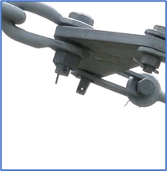
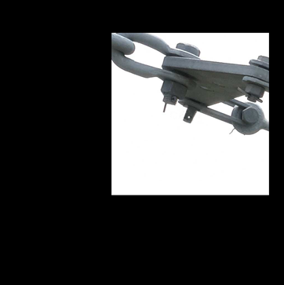
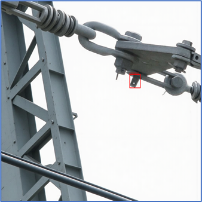

<div align="center">

# OneReward-based_DataAugmentationTool

**基于 OneReward 的目标检测数据集自动增强工具**

用掩码引导的生成式图像编辑做数据增强：**目标不变、背景变化**。标注随坐标变换自动迁移，新增样本零人工标注成本。

[](https://www.python.org/)
[](https://pytorch.org/)
[](https://huggingface.co/docs/diffusers)
[](https://one-reward.github.io)
[](./LICENSE)
[](https://github.com/QingLi-233/OneReward-based_DataAugmentationTool/stargazers)
[](https://github.com/QingLi-233/OneReward-based_DataAugmentationTool/network/members)
[](https://github.com/QingLi-233/OneReward-based_DataAugmentationTool/issues)

简体中文

</div>

---

## 📸 效果展示 | Demo

### 背景改换（电网场景）

**① 原始采集图像**


**② 依据标注框截取缺陷螺栓及周围细节**



**③ 放入 1024×1024 画布并随机偏移，生成 mask（黑=保留，白=待生成）**



**④ OneReward 填充背景，提示词指向电网场景**


**⑤ 标注迁移，生成可直接用于训练的图像 + XML**



> 目标螺栓的形态、材质、缺陷细节完全来自原图，只有背景是生成的。

---

## 💡 为什么做这个 | Motivation

输电线路螺栓缺陷检测的痛点不是模型不够强，而是**数据不够、标注太贵**：

| 痛点 | 常规解法 | 问题 |
| :--- | :--- | :--- |
| 缺陷样本稀少 | 图像增广（翻转 / 旋转 / Mosaic） | 背景不变，模型仍会学到背景特征 |
| 场景单一 | 换一批图片继续标 | 人工成本高、周期长 |
| 小目标样本不足 | 直接缩放原图 | 缩放后细节失真，缺陷特征被破坏 |

本项目的思路：**缺陷目标保持像素级真实，只有背景是生成的。**

- ✅ 缺陷形态、锈蚀、裂纹等细节 100% 来自原图，不存在生成模型"编造缺陷"的风险
- ✅ 背景可任意替换，模型被迫关注**螺栓结构本身**而非背景纹理
- ✅ 标注坐标随仿射变换自动迁移，**新增样本零人工标注成本**
- ✅ 改几行代码即可支持**一图多目标**（复制粘贴多个裁剪块到同一画布）

---

## ✨ 功能特性 | Features

- 🎯 **两阶段生成管线** — 阶段一背景改换（340 张）+ 阶段二小目标模拟（108 张）
- 🏷️ **标注自动迁移** — 读取原 Pascal VOC XML，按「原图 → 裁剪图 → 新画布」两级映射重算 bbox
- 📐 **两种裁剪模式** — `expand` 按倍率外扩保留上下文 / `fixed` 以中心固定外扩得到正方形
- 🎲 **随机偏移 + 多样性** — 随机种子控制位置偏移，重复运行同一原图可扩出背景各异的新样本
- 🧠 **OneReward 双重模型可选** — `onereward`（Alg.1 固定参考模型）/ `dynamic`（Alg.2 EMA 动态参考模型）
- 💾 **全链路中间产物留存** — 原图、裁剪图、填充前画布、mask、生成图、XML、参数记录全部落盘，可溯源可复现
- 🧮 **低显存友好** — VAE 分块 + 模型级 / 逐层 offload + attention 分块，单卡可跑

---

## 🛠 技术栈 | Tech Stack

| 模块 | 选型 | 说明 |
| :--- | :--- | :--- |
| 生成模型 | **OneReward**（FLUX Fill [dev]） | 掩码引导填充，RL 对齐后生成质量优于原始 FLUX Fill [dev] |
| 推理框架 | **Diffusers** `FluxFillCFGPipeline` | 支持 `true_cfg` 参数（OneReward 扩展） |
| 深度学习 | **PyTorch** + **bfloat16** | 需 Ampere 及以上架构 |
| 图像处理 | **Pillow** | 裁剪、画布合成、mask 绘制 |
| 标注格式 | **Pascal VOC XML** | 与主流检测训练框架（YOLO 等）可互转 |
| 检测验证 | **YOLO11n** | 对照实验的基线检测模型 |

### 关于 OneReward

[OneReward](https://one-reward.github.io)（ByteDance，arXiv:2508.21066）用**单个 VLM 作为统一奖励模型**做多任务强化学习：把任务 ID 和评估维度写进 query，让 VLM 直接判断"第一张图是否比第二张好"，取 `Yes` token 的概率作为奖励。

这样做的价值在于——**不需要为每个任务单独做 SFT**。官方开源了 `FLUX Fill [dev][OneReward]` 与 `FLUX Fill [dev][OneRewardDynamic]` 两套 transformer 权重，本项目直接调用。

其 RL 目标为：

```
J(θ) = max(0, λ − P_φ(y⁺ | π_θ(c), π_ref(c), q))
```

`λ` 是奖励上界，用于防止 reward hacking。

---

## 📋 环境要求 | Requirements

### 硬件

| 项目 | 要求 |
| :--- | :--- |
| GPU | **NVIDIA，Compute Capability ≥ 8.0**（A100 / 4090 / 3090 等，bfloat16 必需） |
| 显存 | ≥ 24 GB 建议（脚本已启用 offload，低显存可降级运行但更慢） |
| 内存 | ≥ 32 GB（offload 期间模型常驻 CPU） |
| 磁盘 | ≥ 40 GB（两个 transformer 权重 + FLUX 基座） |

### 软件

```
Python      3.10
PyTorch     2.x (CUDA 12.1+)
diffusers   >= 0.35.0
transformers >= 4.51.3      # OneReward 依赖 Qwen2.5-VL
Pillow      >= 10.0
```

---

## 🚀 快速开始 | Quick Start

### 1. 克隆并安装依赖

```bash
git clone https://github.com/QingLi-233/YOLOv8n-based_AimBot_for_CS2
cd DefectBolt-Aug
pip install -r requirements.txt
```

### 2. 准备模型权重

**方式 A：直接用 HF 仓库 id**（脚本默认值，首次运行自动下载）

```python
# better_run.py 中已内置
--one_reward_root bytedance-research/OneReward \
--flux_root       black-forest-labs/FLUX.1-Fill-dev
```

`--one_reward_root` 会按 `subfolder` 自动定位到：

| 子目录 | 对应策略 |
| :--- | :--- |
| `flux.1-fill-dev-OneReward-transformer` | Alg. 1（固定参考模型） |
| `flux.1-fill-dev-OneRewardDynamic-transformer` | Alg. 2（EMA 动态参考模型） |

**方式 B：预先下载到本地**

```bash
huggingface-cli download bytedance-research/OneReward --local-dir models/oneReward
huggingface-cli download black-forest-labs/FLUX.1-Fill-dev --local-dir models/flux

python better_run_betch.py ... \
    --one_reward_root models/oneReward \
    --flux_root models/flux
```

> ⚠️ `FluxFillCFGPipeline` **不在官方 diffusers 中**。若使用本地权重，需把 OneReward 仓库的 `src/` 加入 `PYTHONPATH`：
> ```bash
> git clone https://github.com/bytedance/OneReward.git
> export PYTHONPATH=$PWD/OneReward:$PYTHONPATH
> ```

### 3. 准备数据

输入必须是 Pascal VOC 格式，且**图像与 XML 同名**：

```
data/office/
├── images/
│   ├── 1766374552.80307.jpg
│   └── ...
└── xmls/
    ├── 1766374552.80307.xml
    └── ...
```

### 4. 生成增强数据

**用法一 —— 背景改换**

```bash
python better_run_betch.py \
    --image_dir data/office/images \
    --xml_root data/office/xmls \
    --output_root outputs/stage1 \
    --crop_mode expand --scale_factor 2.0 --shift_range 256 \
    --prompt "$(cat prompts/stage1_grid.txt)" \
    --negative_prompt "$(cat prompts/stage1_grid_negative.txt)" \
    --steps 40 \
    --model_type dynamic
```

**用法二 —— 小目标模拟（**

输入直接接阶段一的产物，提示词换成自然场景：

```bash
python better_run_betch.py \
    --image_dir outputs/stage1/images \
    --xml_root outputs/stage1/xmls \
    --output_root outputs/stage2 \
    --crop_mode fixed --fixed_pixels 448 --shift_range 150 \
    --prompt "$(cat prompts/stage2_scenery.txt)" \
    --negative_prompt "$(cat prompts/stage2_scenery_negative.txt)" \
    --steps 40 \
    --model_type dynamic
```

**单张图调试**用 `better_run.py`：

```bash
python better_run.py --image data/office/images/1766374552.80307.jpg \
    --xml_root data/office/xmls --output_root outputs/debug \
    --scale_factor 2.0 --shift_range 256 --steps 40
```

---

## ⚙️ 参数说明 | CLI Reference

| 参数 | 默认值 | 说明 |
| :--- | :--- | :--- |
| `--image` / `--image_dir` | *必填* | 输入图像（文件 / 目录） |
| `--xml_root` | *必填* | Pascal VOC XML 根目录 |
| `--output_root` | *必填* | 输出根目录 |
| `--crop_mode` | `expand` | `expand` 按倍率外扩 / `fixed` 以中心固定外扩像素 |
| `--scale_factor` | `1.0` | `expand` 模式下的 bbox 扩大倍率 |
| `--fixed_pixels` | `100` | `fixed` 模式下向四周扩展的像素数 |
| `--shift_range` | `0` | 画布内随机偏移范围（像素），`0` 为居中 |
| `--seed` | `42` | 单图模式的随机种子 |
| `--prompt` | `high-definition, perfect composition` | 填充提示词 |
| `--negative_prompt` | `nsfw` | 负向提示词 |
| `--steps` | `50` | 推理步数，实测 `40` 性价比更高 |
| `--guidance_scale` | `1.0` | CFG 引导强度 |
| `--true_cfg` | `4.0` | OneReward 扩展的 true-CFG |
| `--model_type` | `onereward` / `dynamic` | 两套 RL 训练策略的权重，见下表 |
| `--one_reward_root` | `bytedance-research/OneReward` | OneReward transformer 权重目录或 HF 仓库 id |
| `--flux_root` | `black-forest-labs/FLUX.1-Fill-dev` | FLUX Fill [dev] 基座目录或 HF 仓库 id |

### `--model_type` 怎么选

| 取值 | 对应算法 | 参考模型 | 特点 |
| :--- | :--- | :--- | :--- |
| `onereward` | Alg. 1 | 固定（预训练参数） | 训练稳定，但参考图质量不足时容易 reward hacking |
| `dynamic` | Alg. 2 | EMA 动态更新 | 参考图随训练同步变强，显存省一份模型，**默认推荐** |

### 负向提示词为什么要写 `extra bolt and nut`

生成模型很容易"顺手"在背景里多画几个螺栓，直接污染检测数据。把 `extra bolt and nut` 写进负向提示词能显著降低这类伪目标；阶段二需要更狠，因此写成 `bolt, nut`。

---

## 🗂 项目结构 | Project Structure

```
DefectBolt-Aug/
├── README.md
├── LICENSE
├── requirements.txt
├── better_run.py              # 单图：背景改换 + 标注迁移（调试 / 单样本验证）
├── better_run_betch.py        # 批量：遍历目录，支持 expand / fixed 两种裁剪模式
├── prompts/
│   ├── stage1_grid.txt             # 阶段一提示词（电网场景）
│   ├── stage1_grid_negative.txt
│   ├── stage2_scenery.txt           # 阶段二提示词（自然场景）
│   └── stage2_scenery_negative.txt
├── src/
│   ├── examples/       # OneReward项目原有demo
│   ├── old_run/        # 旧版背景改换代码
│   ├── tools/
│   │   ├── test/       # 一些测试代码
│   │   └── tool_of_dataset # 数据集相关自动化脚本
│   └── pipeline_flux_fill_with_cfg.py # 配置文件
└── docs/
    └── images/              # README 配图
```

### 单次生成的输出目录

```
outputs/stage1/1766374552.80307-6534511/
├── 1766374552.80307.jpg     # ① 原始图像（副本）
├── crop.png                 # ② 依据 bbox 裁剪的目标区域
├── canvas_before_fill.png   # ③ 填充前的 1024×1024 画布
├── mask.png                 # ④ mask：黑=保留目标，白=待生成背景
├── output_filled.png        # ⑤ OneReward 生成结果
├── 1766374552.80307.xml     # ⑥ 坐标迁移后的标注
└── params.txt               # ⑦ 全部参数与几何信息，可溯源
```

批量模式还会在 `outputs/stage1/run_params.txt` 记录一次运行的全局参数。

---

## 🔬 对照实验 | Evaluation

为验证生成式增强是否真的带来收益，设计了严格的对照实验：

- **对照组**：仅用原始数据集训练
- **实验组**：原始数据集 + 448 张生成增强数据（一阶段 340 + 二阶段 108）训练
- **约束**：两组使用**同一个测试集**，检测器统一为 **YOLO11n**

> 关键设计：测试集**完全不使用**生成数据，避免信息泄漏导致指标虚高。

---

## 🗺 后续计划 | Roadmap

- [x] 阶段一：基于标注框的背景改换 + 标注自动迁移
- [x] 阶段二：小目标占比模拟
- [x] 单图 / 批量双脚本，支持两种裁剪模式
- [ ] **补充对照实验结果**并填入上表
- [ ] **一图多目标** — 循环复制粘贴多个裁剪块到同一画布，单图扩出多目标样本
- [ ] **数据集打包** — 输出目录自动转 YOLO `txt` 格式，一键拼 train/val 划分
- [ ] **质量门控** — 对生成图做自动校验（目标数量、bbox 越界率），过滤不合格样本
- [ ] **多模型对比** — 引入 Stable Diffusion Inpaint 做基线，验证 OneReward 的增益
- [ ] **断点续跑** — 跳过已生成目录，支持中途恢复批量任务

---

## ❓ 常见问题 | FAQ

**Q：为什么不用 SD Inpaint，非要用 OneReward？**

OneReward 是 RL 对齐后的 FLUX Fill，在填充质量、背景一致性和物体控制上都优于原始 FLUX Fill [dev]；更重要的是它对"不要多画物体"这类约束的服从度更好，直接关系到生成数据能不能用作检测训练集。

**Q：生成的目标会有畸变吗？**

目标区域**完全不被重绘**——mask 在目标区域为 0，模型只填充外围背景。畸变风险只存在于背景区域。

**Q：`shift_range` 调大有什么影响？**

目标在画布中的位置更随机，模拟真实拍摄中目标不居中的情况。代价是偏移量过大时背景生成的空间变小，细节可能变差，建议 ≤ 256。

**Q：单张图生成要多久？**

`steps=40`、1024×1024、开启 offload 的情况下，单卡约几十秒到一分钟，取决于显存带宽。

**Q：显存不够怎么办？**

脚本默认已开启 `enable_sequential_cpu_offload()`（批量版）和 `enable_model_cpu_offload()` + `enable_attention_slicing()`（单图版）。还不够可下调 `--steps`，或改用 fp16 并关闭 offload。

---

## 📄 开源协议 | License

本项目代码基于 [MIT License](./LICENSE) 开源。

> ⚠️ **上游依赖各有独立协议，且均不允许商用**：
>
> | 依赖 | 协议 |
> | :--- | :--- |
> | OneReward 代码 | Apache License 2.0 |
> | OneReward 权重（`bytedance-research/OneReward`） | **CC BY-NC 4.0** |
> | FLUX.1-Fill-dev 基座 | **FLUX.1 [dev] Non-Commercial License** |
>
> 本仓库的 MIT 只覆盖**本项目自己的代码**，不覆盖上述任何一项。商用前请逐一确认。
> 生成数据中包含电力设施图像，用于训练前请确认符合数据来源地的合规要求。

---

## 🙏 致谢 | Acknowledgements

- [OneReward](https://github.com/bytedance/OneReward) · [权重 on HuggingFace](https://huggingface.co/bytedance-research/OneReward) · [项目主页](https://one-reward.github.io) — ByteDance
- [OneReward 论文](https://arxiv.org/abs/2508.21066) — *OneReward: Unified Mask-Guided Image Generation via Multi-Task Human Preference Learning*
- [FLUX](https://github.com/black-forest-labs/flux) — Black Forest Labs
- [Ultralytics](https://github.com/ultralytics/ultralytics) — YOLO11n 检测器
